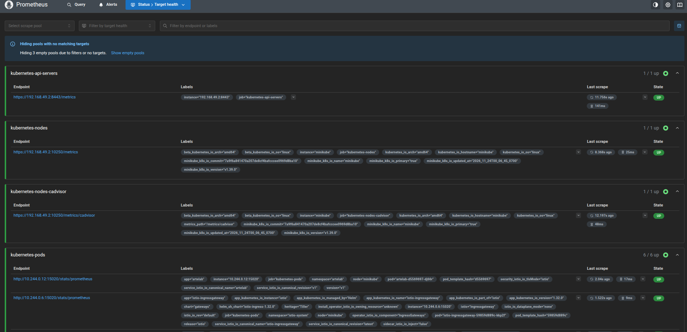
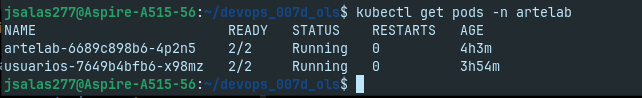
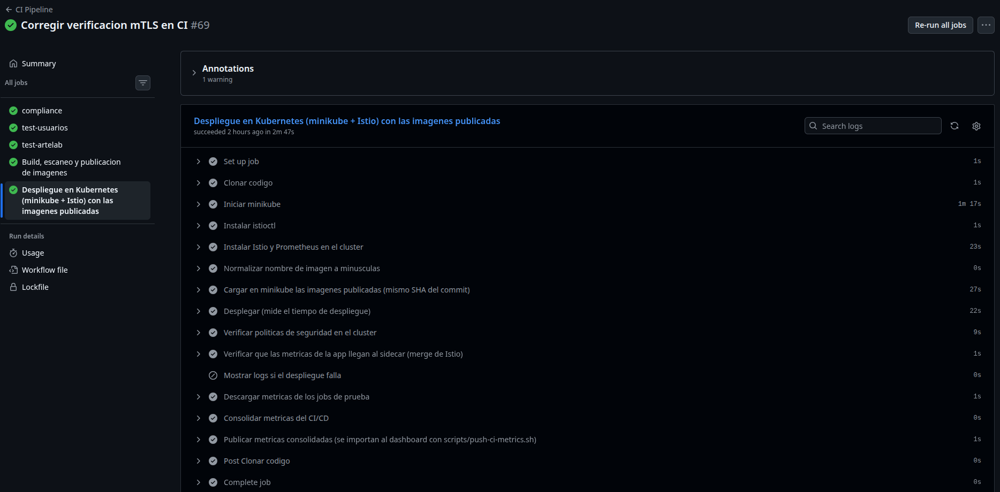
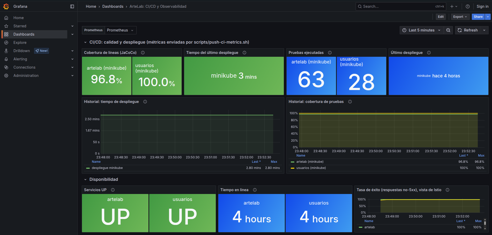
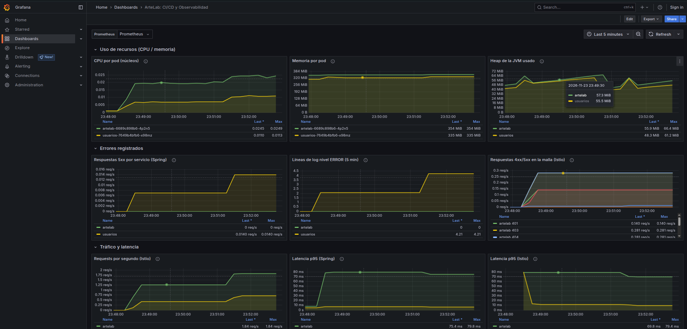
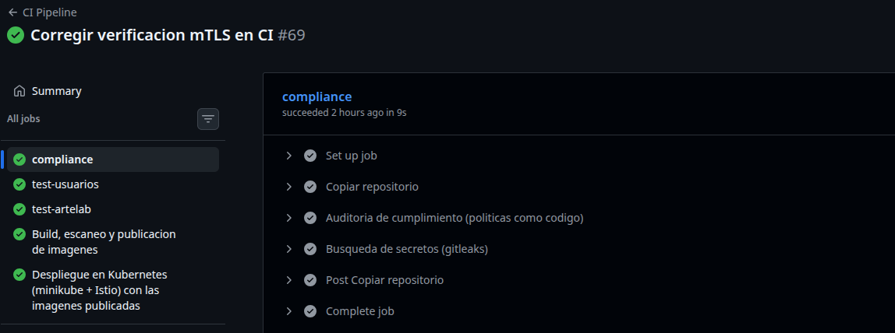
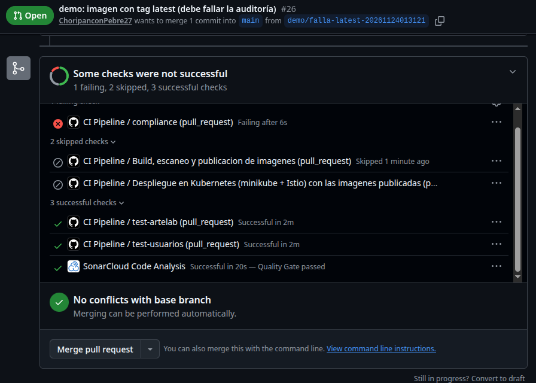

# Evidencias — Evaluación Parcial 3 (DOY0101 Ingeniería DevOps)

**Proyecto:** ArteLab SPA — microservicios `artelab` y `usuarios`
**Integrantes:** (nombre 1) · (nombre 2)
**Repositorio:** (enlace de GitHub)
**Ejecución del pipeline usada como evidencia:** CI Pipeline #69, commit «Corregir verificacion mTLS en CI»

> Este documento reúne las capturas y la explicación de cómo cada evidencia cumple un indicador de la pauta.
> La documentación técnica completa (arquitectura, tablas de herramientas, limitaciones) está en el [README](../README.md).

## Resumen de cobertura

| Indicador | Evidencia en este documento | Código que la respalda |
|---|---|---|
| IE1 Monitoreo | §1 | `k8s/*.yaml`, `application.properties`, Prometheus de Istio |
| IE2 Despliegue orquestado | §2 | `k8s/`, `scripts/04-deploy.sh`, job `deploy-k8s` |
| IE3 Dashboard | §3 | `k8s/monitoring/dashboards/artelab-observabilidad.json`, `scripts/push-ci-metrics.sh` |
| IE4 Documentación de la integración | §4 | README §6 |
| IE5 Políticas de cumplimiento | §5 | `scripts/audit-compliance.sh`, `k8s/istio/`, SonarCloud, Snyk, Trivy, gitleaks |
| IE6 El pipeline se detiene | §6 | `needs:` del workflow, `scripts/demo-falla-pipeline.sh` |

---

## 1. Monitoreo (IE1)

Prometheus (addon de Istio) recoge las métricas de los pods. Cada pod de la aplicación expone su
`/actuator/prometheus` fusionado con las métricas de Envoy en el puerto 15020 del sidecar; las anotaciones
`prometheus.io/*` de los manifiestos hacen posible el scrape incluso con mTLS estricto.



*Figura 1. Prometheus → Status → Target health. Los grupos `kubernetes-api-servers`, `kubernetes-nodes` y
`kubernetes-nodes-cadvisor` están en 1/1 UP, y `kubernetes-pods` en 6/6 UP. Entre los pods aparecen el de `artelab`
(`namespace="artelab"`, scrape en `:15020/stats/prometheus`) y el `istio-ingressgateway`.*

| Necesidad de la pauta | Fuente | Dónde se ve |
|---|---|---|
| Métricas de uso | cAdvisor + Micrometer | Dashboard, fila «Uso de recursos» (§3) |
| Errores | `http_server_requests_seconds_count{status=~"5.."}`, `logback_events_total{level="error"}`, `istio_requests_total` | Dashboard, fila «Errores registrados» (§3) |
| Disponibilidad | métrica `up`, `process_uptime_seconds` | Dashboard, fila «Disponibilidad» (§3) |
| Logs | Logs JSON de la app y access logs de Envoy | `kubectl logs <pod> -c <app>` / `-c istio-proxy` |

## 2. Despliegue en Kubernetes (IE2)

Los dos microservicios se despliegan en minikube con Istio, tanto localmente como en el pipeline (job `deploy-k8s`).
El namespace `artelab` tiene `istio-injection=enabled`, por lo que cada pod recibe automáticamente el sidecar.



*Figura 2. `kubectl get pods -n artelab`: `artelab` y `usuarios` en `Running`, `READY 2/2` (aplicación + `istio-proxy`),
0 reinicios, con 4 h 3 min y 3 h 54 min de vida.*

Configuración de observabilidad que se aplica de forma automatizada en el despliegue (`scripts/04-deploy.sh`):

- Sidecar de Istio inyectado por etiqueta del namespace.
- Anotaciones `prometheus.io/*` en los pods.
- Sondas `startup`, `readiness` y `liveness` contra `/actuator/health/*`.
- `PeerAuthentication` STRICT y `AuthorizationPolicy` (`k8s/istio/`).
- Telemetría de Istio con access logs (`k8s/istio/30-telemetry.yaml`).



*Figura 3. CI Pipeline #69, job «Despliegue en Kubernetes (minikube + Istio) con las imágenes publicadas»: éxito en
2 min 47 s. Se ven los pasos «Instalar Istio y Prometheus», «Cargar en minikube las imágenes publicadas (mismo SHA del
commit)», «Desplegar (mide el tiempo de despliegue)», «Verificar políticas de seguridad en el clúster» y
«Verificar que las métricas de la app llegan al sidecar». El paso «Mostrar logs si el despliegue falla» queda omitido porque
no hubo falla.*

## 3. Dashboard (IE3)

Dashboard de Grafana «ArteLab: CI/CD y Observabilidad», definido como código en
`k8s/monitoring/dashboards/artelab-observabilidad.json` e importado por `scripts/02-observabilidad.sh`.

### 3.1 Métricas de CI/CD y disponibilidad



*Figura 4. Fila «CI/CD: calidad y despliegue»: cobertura de líneas JaCoCo (artelab 96,8 %, usuarios 100 %), pruebas
ejecutadas (63 y 28), tiempo del último despliegue (2,80 min) e historiales. Fila «Disponibilidad»: ambos servicios
`UP`, 4 horas en línea y tasa de éxito de Istio.*

Las métricas `ci_*` las produce el propio pipeline: cada job de pruebas genera `ci-metrics-<servicio>.prom`
(`scripts/ci-metrics.sh`), `deploy-k8s` agrega el tiempo de despliegue y publica el artefacto `ci-metrics`. Se cargan
al dashboard con `scripts/push-ci-metrics.sh`, que las envía al Pushgateway.

### 3.2 Recursos, errores y tráfico



*Figura 5. «Uso de recursos»: CPU por pod, memoria por pod (≈354 MiB y ≈335 MiB) y heap de la JVM. «Errores registrados»:
5xx por servicio, líneas de log nivel ERROR y respuestas 4xx/5xx en la malla (401, 403, 404). «Tráfico y latencia»:
requests por segundo y latencia p95 medidos en Spring y en Istio.*

Los datos de errores y tráfico se generaron con `scripts/05-generar-trafico.sh`, que incluye errores intencionales
(credenciales inválidas, recursos inexistentes, acceso sin token y acceso denegado a Actuator).

| Métrica pedida por la pauta | Panel |
|---|---|
| Tiempo de despliegue | «Tiempo del último despliegue» e «Historial: tiempo de despliegue» |
| Cobertura de pruebas | «Cobertura de líneas (JaCoCo)» e «Historial: cobertura de pruebas» |
| Uso de CPU/memoria | «CPU por pod», «Memoria por pod», «Heap de la JVM usado» |
| Errores registrados | «Respuestas 5xx por servicio», «Líneas de log nivel ERROR», «Respuestas 4xx/5xx en la malla» |

## 4. Integración en el pipeline y toma de decisiones (IE4)

Flujo del pipeline (`.github/workflows/ci.yml`):

```
push / PR a develop o main
 ├─ compliance ─ audit-compliance.sh + gitleaks
 ├─ test-usuarios ─ Snyk → pruebas + JaCoCo ≥ 80 % → ci-metrics → SonarCloud (Quality Gate)
 ├─ test-artelab  ─ (igual)
 └─ build-docker (needs: los 3 anteriores) ─ build → Trivy → push a ghcr.io
     └─ deploy-k8s ─ minikube + Istio → despliegue → verify-policies.sh → ci-metrics.prom
```

La tabla «herramienta → pregunta que responde → decisión que habilita» está en el [README §6](../README.md#6-cómo-se-integran-las-herramientas-en-el-pipeline-ie4).

### Decisiones técnicas tomadas a partir de las métricas

Al revisar las métricas del dashboard sobre los datos de testeo, se llevó a la conclusión que no era necesario hacer cambios debido a que la cobertura supera en ambos casos el 80% (96,8 y 100%) y los servicios se mantuvieron en UP, por lo tanto no se necesitó de ajustes.

## 5. Políticas de cumplimiento (IE5)



*Figura 6. Job `compliance` del pipeline #69, exitoso en 9 s: «Auditoría de cumplimiento (políticas como código)» y
«Búsqueda de secretos (gitleaks)».*

| Política | Herramienta | Dónde se aplica |
|---|---|---|
| Higiene del repo, contenedores no root, manifiestos con probes, límites y tag fijo, sin Secrets versionados, mTLS STRICT, Actuator denegado, CI sin `continue-on-error` | `scripts/audit-compliance.sh` | Job `compliance` |
| Cobertura de líneas ≥ 80 % | JaCoCo (`pom.xml`) | `./mvnw verify` en `test-*` |
| Calidad y seguridad del código | SonarCloud con `sonar.qualitygate.wait=true` | `main` y PR hacia `main` |
| Dependencias con vulnerabilidades críticas | Snyk (`--severity-threshold=critical`) | Jobs `test-*` |
| Imágenes con vulnerabilidades críticas corregibles | Trivy (`--exit-code 1`) | Job `build-docker`, antes de publicar |
| Secretos en el código | gitleaks | Job `compliance` |
| Quién puede llamar a quién | `PeerAuthentication` STRICT + `AuthorizationPolicy` | Cluster; probado con `scripts/verify-policies.sh` |
| Cambios solo por PR con checks | Branch protection | GitHub, rama `main` |

La verificación en el clúster (`scripts/verify-policies.sh`, paso «Verificar políticas de seguridad en el cluster» de la Figura 3)
comprueba cuatro cosas: Actuator y `/lookup` responden 403 desde el gateway, un pod sin sidecar no logra conectarse
a `usuarios` (mTLS estricto) y el login legítimo sigue respondiendo 200.

## 6. El pipeline se detiene ante una falla crítica (IE6)

### 6.1 Mecanismo

`build-docker` declara `needs: [compliance, test-usuarios, test-artelab]` y `deploy-k8s` declara `needs: build-docker`.
Si cualquier control falla, los jobs siguientes quedan omitidos y no se publica ni despliega nada.

| Control | Falla que lo activa | Job que se detiene |
|---|---|---|
| Auditoría de cumplimiento | Manifiesto con imagen `:latest`, mTLS desactivado, etc. | `compliance` |
| gitleaks | Credencial en el código | `compliance` |
| Pruebas unitarias | Prueba que falla | `test-usuarios` / `test-artelab` |
| JaCoCo | Cobertura < 80 % | `test-*` |
| Snyk | Dependencia con vulnerabilidad crítica | `test-*` |
| SonarCloud | Quality Gate no cumplido | `test-*` |
| Trivy | Imagen con vulnerabilidad crítica corregible | `build-docker` |
| `verify-policies.sh` | Política de Istio incumplida | `deploy-k8s` |

### 6.2 Evidencia de la falla

Para demostrarlo se ejecutó `scripts/demo-falla-pipeline.sh latest`, que crea la rama
`demo/falla-latest-20261124013121` (nunca toca `main`) con una falla intencional: el manifiesto
`k8s/10-usuarios.yaml` usa una imagen con tag `:latest`. Antes de subirla, la auditoría local ya detecta el
incumplimiento (`AUDITORÍA FALLIDA: 1 incumplimiento(s)`). Luego se abrió el Pull Request #26 hacia `main`.



*Figura 7. Pull Request #26 «demo: imagen con tag latest (debe fallar la auditoría)». El job `compliance` falla a los
6 s. Como consecuencia, «Build, escaneo y publicación de imágenes» y «Despliegue en Kubernetes» quedan en *skipped*:
no se publica ninguna imagen ni se despliega nada. Los jobs `test-artelab`, `test-usuarios` y SonarCloud
(Quality Gate passed) sí terminan en verde, ya que la falla provocada solo afecta al control de cumplimiento.*

El PR se cerró sin hacer merge, por lo que la falla no llegó a `main`.

### 6.3 Contraste: ejecución exitosa

La Figura 3 corresponde a la ejecución #69 sin fallas: los cinco jobs (`compliance`, `test-usuarios`, `test-artelab`,
`build-docker` y `deploy-k8s`) terminan en verde.